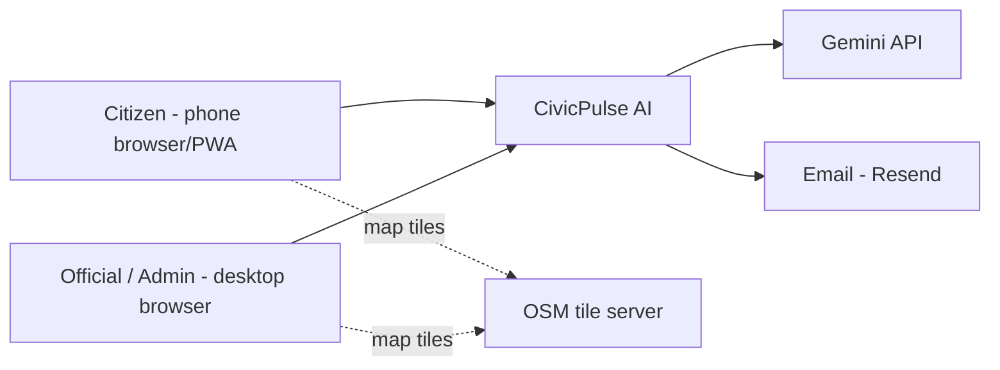
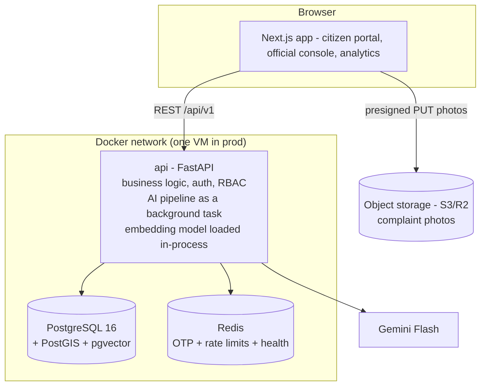

# Architecture — CivicPulse AI

## System context



## Container diagram (what actually runs)



**Running services:**

| Service | Image | Why it exists |
|---|---|---|
| `frontend` | node (Next.js) | All UIs in one app, role-based layouts |
| `api` | python (FastAPI + fastembed) | Business logic, auth, RBAC, and the AI pipeline (run as a FastAPI background task) |
| `postgres`, `redis` | official | Data; OTP + rate limits |

One real deployable backend — not ten nano-services.

## The async pipeline is the spine

Everything AI happens **off the request path** (see F7 in 02-user-flows.md). The API's job is: validate → persist → schedule the pipeline as a background task → return 201 in <300 ms. The pipeline's job is: take its time, write decisions + confidence back.

Rules:
1. Tasks carry IDs, not data. They re-read state from Postgres (no stale blobs).
2. Every task is idempotent — re-running `run_pipeline` on a triaged complaint is a no-op.
3. Every step logs to `ai_jobs` (model, latency, confidence). When dedup misbehaves, you debug from data, not vibes.
4. On failure the complaint is parked `needs_manual_triage`, never lost.

## Repository structure (monorepo)

```
civicpulse/
├── docs/                      # these documents
├── frontend/                  # Next.js 15 + TS strict + Tailwind + shadcn/ui
│   └── src/app/(public) (citizen) (console) (admin)
├── backend/
│   ├── pyproject.toml         # uv; dependency groups: [api] light, [ai] torch etc.
│   ├── app/
│   │   ├── core/              # config, security (JWT, argon2), deps (RBAC)
│   │   ├── models/            # SQLAlchemy 2.0 + GeoAlchemy2 + pgvector types
│   │   ├── schemas/           # Pydantic v2 (single source of API truth)
│   │   ├── api/v1/            # routers: auth, complaints, issues, analytics, admin...
│   │   ├── services/          # domain logic (issue lifecycle, priority)
│   │   └── ai/                # pipeline steps, llm adapter (gemini/mock), embeddings
│   ├── alembic/               # migrations
│   └── tests/
├── ml/                        # eval sets, threshold tuning
│   └── eval/                  # labeled data + metric scripts (committed!)
├── scripts/seed.py            # synthetic city data generator
├── docker-compose.yml         # dev: pg, redis, minio
├── docker-compose.prod.yml    # prod overrides + caddy
└── .github/workflows/ci.yml   # ruff, pytest, mypy-light, eslint, tsc, build
```

One backend codebase and one image, so `models/` and `schemas/` can't drift apart — the classic microservice failure for solo devs.

## Architecture Decision Records

### ADR-01 — Modular monolith, not microservices
**Decision:** One backend deployable (`api`) with module boundaries inside it.
**Why:** Microservices solve org-scaling problems you don't have, and cost you distributed debugging, network failure modes, and deploy complexity you can't afford solo. The requirement "microservice-friendly" is satisfied by clean module seams — splitting later is mechanical.
**Revisit when:** a second team works on this, or one component needs independent scaling for real load.

### ADR-02 — pgvector replaces FAISS
**Decision:** Embeddings live in Postgres (`vector(384)` + HNSW). FAISS removed from the stack.
**Why:** Dedup needs *filtered* similarity (category + radius + open-status + vector). With FAISS that's two systems to sync, no persistence story, no transactional consistency. At your scale (≤ a few hundred thousand complaints), pgvector is faster to build, impossible to desync, and the SQL is interview gold. FAISS earns its place at tens of millions of vectors with pure ANN workloads.
**Revisit when:** >5–10 M vectors or recall/latency targets pgvector can't hit.

### ADR-03 — PostGIS is mandatory, not optional
**Decision:** PostGIS for all geospatial work: ward point-in-polygon, ST_DWithin dedup radius, grid heatmaps.
**Why:** Half the product's features are geospatial. Doing this in Python (shapely loops over rows) is 100× slower and a re-implementation of solved problems. The original spec listed plain PostgreSQL — that was the single biggest gap.

> ADR numbers are stable identifiers. Decisions for features that were removed (a separate job queue/worker, computer-vision verification, forecasting) are omitted, so numbering has gaps.

### ADR-04 — FastAPI BackgroundTasks for the pipeline, no separate queue
**Decision:** The AI pipeline runs as a FastAPI `BackgroundTask` inside the API process. Redis is kept for OTP storage, rate limiting and the health check.
**Why:** One fewer process to deploy and operate. The pipeline is idempotent and failure-tolerant (`needs_manual_triage`), so there is no need for a durable queue at this scale.
**Trade-off:** A task in flight when the API process dies is not retried automatically; the complaint stays in `queued`/`processing` until an official triages it.

### ADR-06 — Object storage with presigned URLs (S3 or R2)
**Decision:** Photos go browser → storage directly via presigned PUT; API stores only `object_key`. Cloudflare R2 preferred (S3-compatible, zero egress fees) with S3 as the AWS-native alternative. **Dev/demo runs MinIO in docker-compose** — same S3 API, zero external accounts; prod swaps endpoint + credentials only.
**Why:** Proxying 8 MB uploads through FastAPI burns your single VM's bandwidth and blocks workers. Presigned URLs are the industry pattern and were missing from the original spec entirely.

### ADR-07 — Auth: build JWT properly, in-house
**Decision:** argon2id hashing, 15-min access JWT, rotating refresh in httpOnly cookie with family reuse-detection, RBAC as FastAPI dependencies.
**Why:** For a portfolio project, auth built correctly *is* the learning objective; Clerk/Auth0 would hide it. The risk of DIY auth is mitigated by following the standard recipe exactly (no inventions).
**Revisit when:** this ever fronts real citizens — then add managed identity/OTP via a provider.

### ADR-08 — Embeddings: `intfloat/multilingual-e5-small` (384-d)
**Decision:** Multilingual model, not an English-only MiniLM.
**Why:** Real complaints arrive in Hindi/Hinglish/English mixed. e5-small handles 100+ languages, runs ~20 ms/sentence on CPU, 384-d keeps the index small. **Gotcha:** e5 requires `"query: "` / `"passage: "` prefixes — forget them and similarity quality silently degrades. Pin the model; changing it means re-embedding everything.

### ADR-11 — LLM behind an adapter; Gemini Flash as provider
**Decision:** All LLM calls go through `app/ai/llm.py` interface: `classify()`, `title()`. Providers: `gemini` | `mock`. `MOCK_AI=true` returns deterministic fixtures.
**Why:** Free-tier quotas, demo-day wifi, provider swaps, and tests all demand the seam. The LLM **never receives raw PII** (strip names/emails from prompts).

### ADR-12 — Maps: MapLibre GL JS + OpenStreetMap tiles
**Decision:** MapLibre (open-source Mapbox fork) + OSM raster tiles; heatmap via built-in heat layer; geocoding via Nominatim (respect 1 req/s policy) only where needed.
**Why:** Google Maps JS requires billing setup and gets expensive; MapLibre is free, and "I built this on open geo stack" is a better story. Ward polygons render as a vector layer from your own GeoJSON.

### ADR-13 — Single-tenant, single city
**Decision:** One deployment = one city. No `city_id` columns, no tenant routing.
**Why:** Multi-tenancy roughly doubles schema/auth/test complexity for zero demo value. Deploy a second compose stack if you ever need a second city.

## Security architecture (checklist, enforced in P6 review)

- [ ] argon2id; constant-time comparisons; generic auth errors (no enumeration)
- [ ] Refresh rotation + family revocation; access token in memory only
- [ ] RBAC dependency on **every** router; deny-by-default; officials row-scoped to dept/wards
- [ ] Pydantic validates everything inbound; file uploads: mime + size + magic-bytes check on confirm
- [ ] Rate limits (Redis): auth 5/min/IP, complaints 10/day/user, similar-check 20/min
- [ ] EXIF stripped when images are served; endpoints expose no reporter PII to citizens or the public
- [ ] Secrets via env only; `.env` gitignored; prod secrets in VM env/SSM — never in compose files
- [ ] HTTPS everywhere (Caddy auto-TLS); CORS locked to the frontend origin; security headers (CSP, HSTS)
- [ ] SQL via SQLAlchemy parameters only (the PostGIS string-building trap — never f-string a coordinate)
- [ ] Audit: who did what when = `issue_status_history` + `corrections` (append-only)
- [ ] Dependency scanning: `uv lock` + `pip-audit`, `pnpm audit` in CI

## Deployment

**Dev (your Windows machine):** Docker Desktop (WSL2). `docker compose up` → everything hot-reloads. No native Python/Postgres on Windows needed — this sidesteps every Windows-specific ML/GIS install problem.

**Prod (AWS, ~$10–12/month):**
```
Lightsail or EC2 t3.small (2 GB)        ← start here, not ECS/EKS
 └─ docker compose -f compose.yml -f compose.prod.yml up -d
     ├─ caddy (auto-HTTPS, reverse proxy: / → frontend, /api → api)
     ├─ frontend (next start)
     ├─ api
     ├─ postgres (volume) · redis
     └─ nightly: pg_dump → R2/S3 (cron)
```
**Why not ECS/EKS/Lambda:** orchestration is a cost center until you have traffic. The compose file *is* your infrastructure-as-code story; the migration path (ECR images → ECS services → RDS) is a documented paragraph, not a prerequisite. Watch the 2 GB RAM: the embedding model lives in the API process — if tight, go t3.medium or use the ONNX-quantized model.

**Observability (free tier):** structured JSON logs (structlog) → `docker logs`; Sentry free plan for API + frontend errors; `/health` endpoints on every service; UptimeRobot ping. `ai_jobs` table doubles as pipeline metrics (latency, failure rate by step — chart it in the admin UI).
